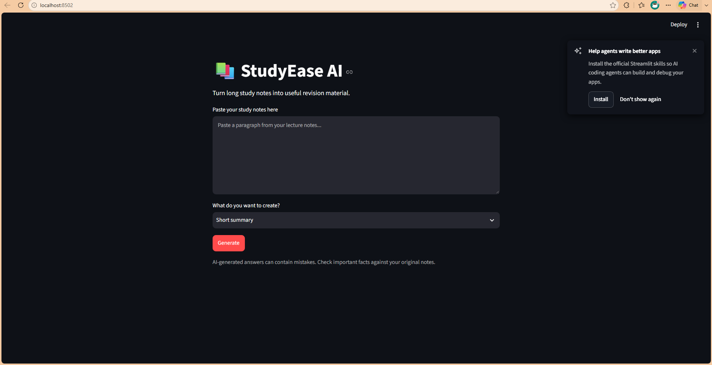
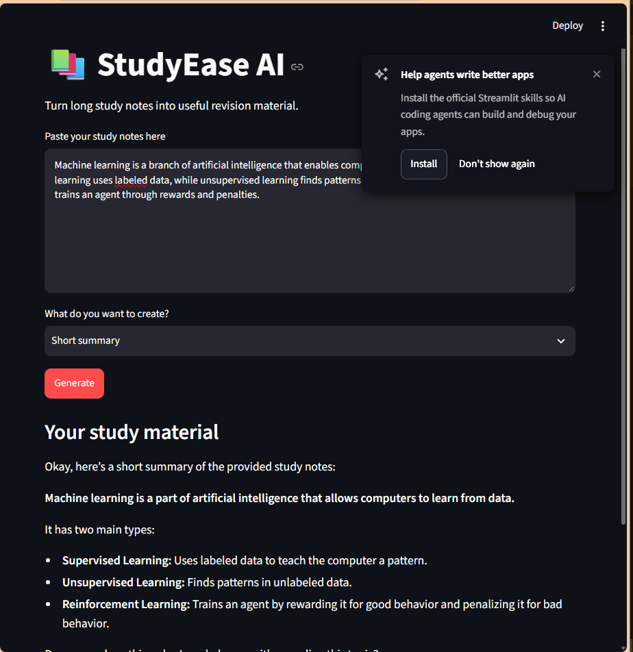
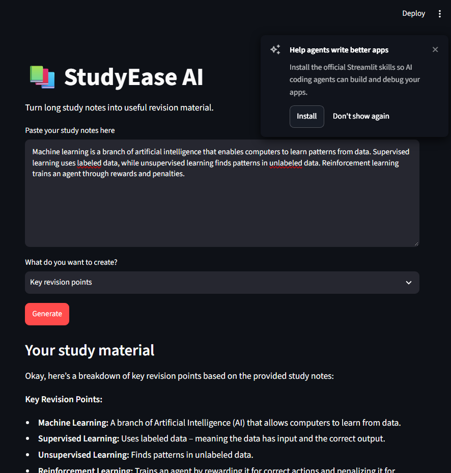
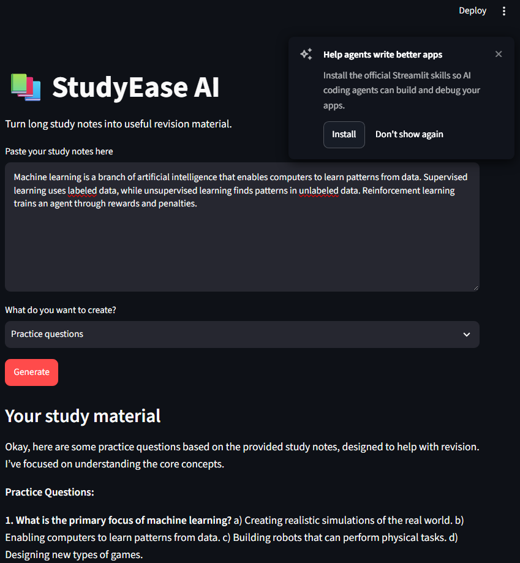
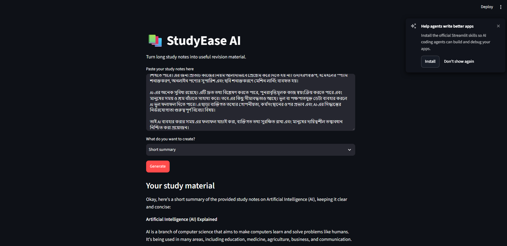

# 📚 StudyEase AI

**An AI-powered study assistant that transforms long study notes into useful revision materials.**

StudyEase AI helps students study more efficiently by turning their notes into short summaries, key revision points, and practice questions using a locally running AI model.

## ✨ Features

- 📝 **Short Summary:** Convert long notes into concise summaries.
- 🎯 **Key Revision Points:** Extract important points for quick revision.
- ❓ **Practice Questions:** Generate practice questions from study notes.
- 🤖 **Local AI Processing:** Uses Ollama with the Gemma 3 1B model.
- 🖥️ **Simple Interface:** Built with Streamlit for an easy-to-use experience.
- 🔒 **Local Model:** Text generation runs through a local Ollama model.

## 🖥️ Application Screenshots

### 1. Application Homepage



### 2. Short Summary



### 3. Key Revision Points



### 4. Practice Questions



### 5. Bengali Notes Test



## 🛠️ Technologies Used

- **Python** — Application logic
- **Streamlit** — Web interface
- **Ollama** — Local AI model runtime
- **Gemma 3 1B** — Language model
- **Requests** — Communication with the Ollama API
- **Git & GitHub** — Version control and project hosting

## 📋 Requirements

Before running StudyEase AI, make sure you have installed:

- Python 3.10 or a compatible version
- Git
- [Ollama](https://ollama.com/)
- The `gemma3:1b` model

## 🚀 Getting Started

### 1. Clone the Repository

```bash
git clone https://github.com/Rehu33/studyease-ai.git
cd studyease-ai
```

### 2. Create a Virtual Environment

**Windows PowerShell:**

```powershell
python -m venv .venv
.venv\Scripts\Activate.ps1
```

### 3. Install Dependencies

```bash
pip install -r requirements.txt
```

### 4. Download the AI Model

Make sure Ollama is installed, then run:

```bash
ollama pull gemma3:1b
```

### 5. Run the Application

```bash
streamlit run app.py
```

The application will open in your browser. If it does not open automatically, follow the local URL displayed in the terminal.

## 📖 How to Use

1. Open StudyEase AI in your browser.
2. Paste your study notes into the text area.
3. Choose one of the available tasks:
   - Short summary
   - Key revision points
   - Practice questions
4. Click **Generate**.
5. Review the generated study material.

## 📁 Project Structure

```text
studyease-ai/
├── app.py
├── requirements.txt
├── README.md
└── screenshots/
    ├── application1.png
    ├── application2.png
    ├── application3.png
    ├── application4.png
    └── application5.png
```

## ⚠️ Disclaimer

StudyEase AI is designed to support learning and revision. AI-generated content may contain errors or omit important information. Always verify important facts against your original notes and trusted learning resources.

## 👩‍💻 Author

**Rehab Alamgir**

- GitHub: [@Rehu33](https://github.com/Rehu33)
- Project Repository: [StudyEase AI](https://github.com/Rehu33/studyease-ai)

## 📄 License

This project is open source. A license has not yet been added. You may use, study, or modify the code, but formal reuse and distribution permissions depend on the license eventually selected for this repository.
